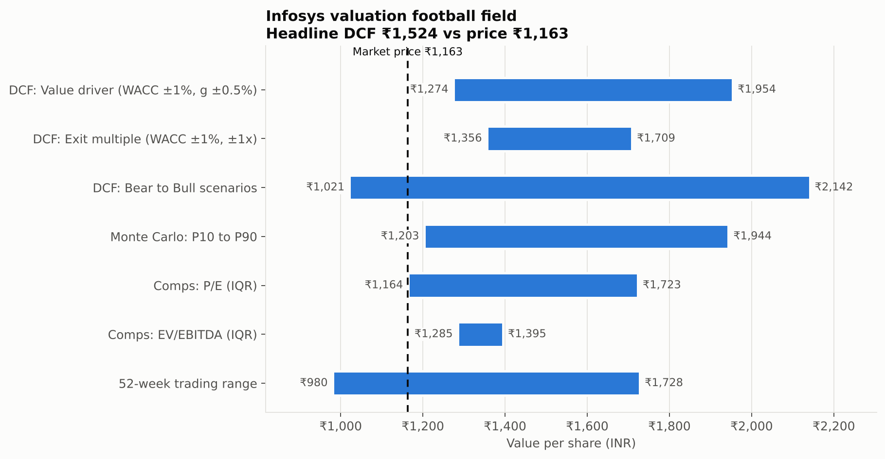
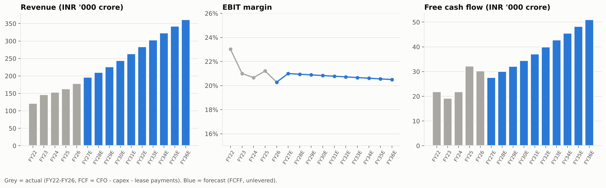
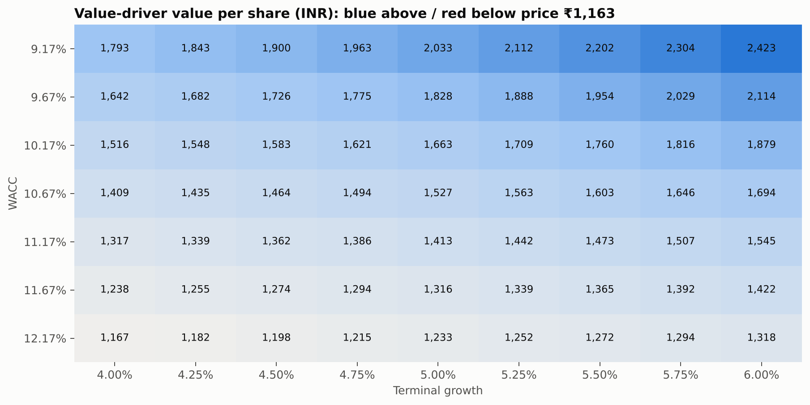
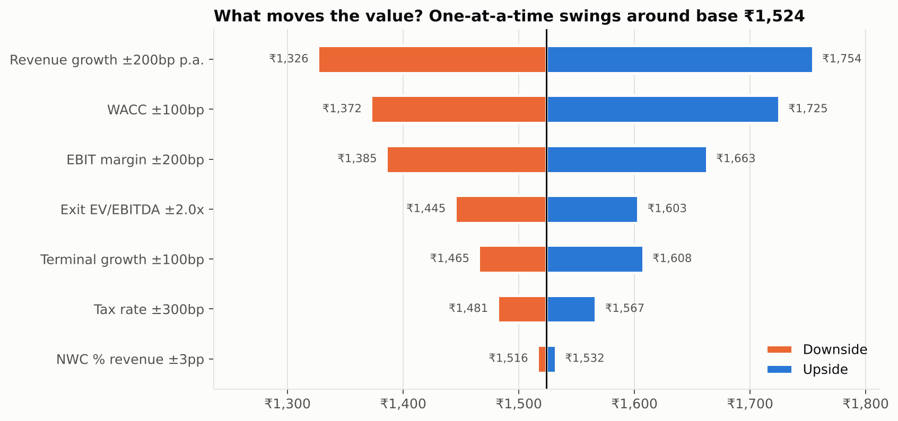
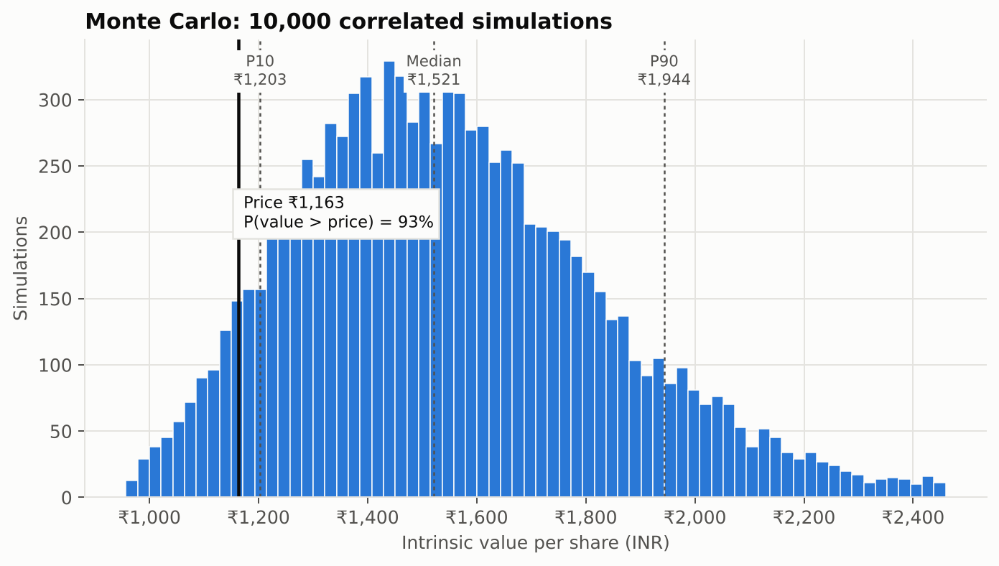

# Infosys DCF valuation

A DCF model of Infosys (NSE: INFY) written in Python. Running it also produces an Excel version of the model with live formulas, so the numbers can be checked and changed in a spreadsheet.

Valuation date: 28 Oct 2026. Share price used: ₹1,163 (NSE close, 27 Oct 2026). Amounts in INR crore unless stated.

Not investment advice.



## Result

My base case comes out at about **₹1,524 per share**, around 31% above the price I used. That number depends heavily on one choice, how to handle India's country risk in the discount rate, so I show both versions:

| | Raw G-Sec yield as risk-free rate | G-Sec less default spread (my base case) |
|---|---:|---:|
| Risk-free rate | 7.40% | 5.53% |
| WACC | 12.5% | 10.7% |
| Value per share | ₹1,270 (+9%) | ₹1,524 (+31%) |

The 10-year government bond yield already includes compensation for India's default risk, and I also add a country risk premium to the cost of equity. Using the raw yield therefore counts part of that risk twice, so for the base case I subtract India's default spread (1.87%) from the yield first, following Damodaran. The raw-yield version is still a useful conservative check.

Base case by method:

| Method | Value per share |
|---|---:|
| DCF, value driver (RONIC 40%) | ₹1,527 |
| DCF, exit multiple (11x EBITDA) | ₹1,521 |
| Headline (50/50 of the two above) | ₹1,524 |
| DCF, Gordon growth on FCFF (shown as a check, not used) | ₹1,589 |
| Bear / base / bull | ₹1,021 / ₹1,524 / ₹2,142 |
| Monte Carlo, 10,000 runs (P10 to P90) | ₹1,203 to ₹1,944, median ₹1,521 |
| Comps, P/E median | ₹1,443 |
| Comps, EV/EBITDA median | ₹1,345 |

**What the market seems to be pricing in.** Running the DCF backwards, the current price matches my forecasts at a WACC of about 12.6%, which is almost exactly what you get using the raw bond yield. Holding my 10.7% WACC instead, the price implies only about 3.4% a year revenue growth in rupees over ten years, which is roughly flat in constant currency once rupee depreciation is taken out. My base case assumes 7.3%. So either the market is applying a higher discount rate than I think is right, or it expects much weaker growth than guidance suggests. That is the real question behind the valuation.

## How to run

```bash
pip install -r requirements.txt
python run_valuation.py                 # uses the saved data in data/
python run_valuation.py --live          # pulls current price, beta and peer multiples (needs yfinance)
python run_valuation.py --scenario bear
pytest
```

All assumptions are in `config/infosys.yaml`. Change them and re-run to update the outputs, the charts and the Excel file. Setting `india_default_spread: 0` gives the raw G-Sec version.

## Approach

### Discount rate (WACC about 10.7%)

- Risk-free rate: 7.40% 10-year G-Sec yield (14 Oct 2026) less India's 1.87% default spread = 5.53%
- Beta: 0.85 raw, adjusted toward 1 (Blume) to 0.90
- Mature-market equity risk premium 4.23%, plus half of India's 2.85% country risk premium (both from Damodaran, Jan 2026). I used half because most of Infosys's revenue comes from outside India, but its costs and delivery are mostly in India.
- Cost of equity: 10.8%
- Infosys has no borrowings. The only debt-like item is lease liabilities, priced at the 10-year AAA corporate yield (8.04%).

The beta is my estimate, not a regression on actual returns. `--live` replaces it with a two-year weekly regression against the NIFTY 50.

### Forecast (FY27 to FY36)



- Revenue growth in INR: 10% in FY27, because the rupee has weakened a lot (H1 FY27 revenue was up 12.3% in rupees even though constant currency guidance is only 1-2%). Then 7-8%, slowing to 5.5% by FY36.
- EBIT margin: 21% falling slightly to 20.5%. Guidance is 20-22%.
- Capex 1.5% of revenue, D&A 2.7%, working capital 10.5% of revenue.
- Tax 26.5%.

A few modelling choices:

- **Stub period.** The valuation date is partway through FY27, so only the remaining part of FY27's cash flow is counted. Cash flows are discounted from the middle of each year.
- **Leases.** Under IFRS 16, depreciation includes leased assets. Since that gets added back, I also subtract new lease additions each year and treat lease liabilities as debt.
- **Stock-based comp** is left in as a cost, not added back.
- **Historical numbers** are in USD in my source, so I converted each year at the exchange rate implied by Infosys's reported INR revenue for that year.
- **Cash** is the ₹45,232 crore of cash and investments at 30 Sep 2026. The ₹26 interim dividend has a record date of 3 Nov, so the 27 Oct price still includes it and no adjustment is needed.

### Terminal value

I calculated it three ways:

- **Value driver:** `NOPAT × (1+g) × (1 − g/RONIC) / (WACC − g)`, with g = 5% and a 40% return on new invested capital. Infosys earned about 49% on its invested capital in FY26, and I assume competition brings that down over time. This forces growth to be paid for with reinvestment.
- **Exit multiple:** 11x final-year EBITDA. That's the multiple consistent with the value driver result, and a little below today's peer median, which seems right for a business that will be growing more slowly in FY36. It implies about 4.6% perpetual growth, slightly below my 5%.
- **Gordon growth on FCFF:** shown but not used in the headline. My forecast reinvests only about 6% of profit in the final year while growing 5%, which implies an 80% return on new capital. That's too generous to rely on.

The headline is a 50/50 blend of the value driver and exit multiple results, which come out within ₹6 of each other.

### Sensitivity





Revenue growth matters most (₹1,326 to ₹1,754 for ±2 percentage points a year), followed by WACC (₹1,372 to ₹1,725 for ±1 point) and margin.

For the Monte Carlo I varied growth, margin, WACC, terminal growth and the exit multiple together, with some correlation between them (for example, higher growth tends to come with better margins). The P10 to P90 range is ₹1,203 to ₹1,944. I chose the input ranges myself and centred them on the base case, so this shows how spread out the value is under my assumptions, not the odds that the stock is undervalued.



### Scenarios

| | Bear | Base | Bull |
|---|---|---|---|
| 10-year revenue growth (INR) | 4.8% a year | 7.3% a year | 9.3% a year |
| Average EBIT margin | 19.3% | 20.8% | 21.8% |
| WACC | 11.4% | 10.7% | 10.2% |
| Terminal growth / exit multiple | 4.0% / 9x | 5.0% / 11x | 5.5% / 13.5x |
| Value per share | ₹1,021 | ₹1,524 | ₹2,142 |

The bear case is AI tools reducing pricing on Infosys's services faster than new AI work makes up for it. The bull case is AI services becoming a real growth driver.

## Excel file

`output/Infosys_DCF_Model.xlsx` has tabs for inputs, historicals, WACC, the DCF, sensitivity tables, scenarios, Monte Carlo results, comps and a summary. Blue cells are inputs and black cells are formulas. On the Inputs tab, cell B42 switches between bear, base and bull, and cell B24 is the default spread (set it to 0 for the raw G-Sec version).

The Monte Carlo, scenario comparison and margin/growth table are pasted in from Python, since Excel can't calculate those directly.

## Files

```
run_valuation.py      runs everything
config/infosys.yaml   assumptions
data/                 saved financial and market data
dcf/                  model code (data, WACC, DCF, analysis, charts, Excel export)
tests/                tests, including a check that the Excel formulas match the Python results
output/               Excel model and CSV/JSON outputs
docs/img/             charts
```

## Data sources

- Financials FY22 to FY26: stockanalysis.com (S&P Global Market Intelligence)
- INR revenue, Q2 FY27 results and cash at 30 Sep 2026: Infosys press releases, Q2 FY27 fact sheet and filings
- Share price: NSE close, 27 Oct 2026
- Bond yields: ICRA Analytics, via the Aditya Birla Sun Life daily fixed income tracker (15 Oct 2026)
- Default spread, country risk premium and mature-market ERP: Damodaran's country risk dataset (Jan 2026)
- Peer multiples: Tapetide, KoalaGains, PitchBook

## Limitations

- Market data is from late October 2026 unless you run with `--live`.
- Lease liabilities and minority interest are from the 30 June 2026 balance sheet (the latest standardized one I had), converted at the Q2 FY27 exchange rate.
- The Damodaran figures are from January 2026, and India's default spread and country risk premium move with its credit spreads.
- The EV/EBITDA comparison only uses three peers, because I couldn't find consistent figures for Wipro and Tech Mahindra. The P/E range is pulled up by Tech Mahindra, which trades at about 28x on depressed earnings.
- Beta is an estimate unless you run with `--live`.

## Note

The choice of company, the assumptions and the analysis are my own.
